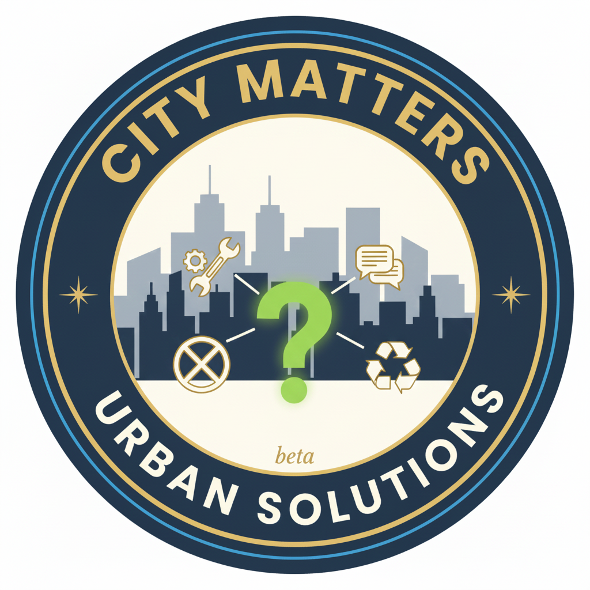

<p align="center">
  
</p>

# City Civic — Municipal Issue Reporting & Resolution System

[](https://github.com/sangmeshwar2006/CITY-CIVIC-/actions/workflows/ci.yml)
[](LICENSE)
[](https://nodejs.org/)
[](https://flutter.dev/)
[](docker-compose.yml)

A production-grade, full-stack civic engagement platform connecting citizens with municipal administration for transparent, location-tagged complaint reporting, triage, and resolution.

---

## Architecture Overview

City Civic is designed as an integrated multi-tier civic platform:

- **`backend/`**: Node.js, Express, MongoDB REST API for user authentication, complaint filing, category tagging, rate limiting, and admin analytics.
- **`admin/`**: React 18 + Vite administration dashboard for civic departments to filter complaints, update statuses, and view analytics.
- **`flutter_app/`**: Flutter cross-platform mobile client for citizens to submit issues with photographic evidence and geolocation.
- **`prototype/`**: Initial responsive HTML/CSS web prototype with interactive reporting screens and issue tracking.

```
+---------------------+         +----------------------+
|  Flutter Mobile App |         | React Vite Dashboard |
|     (Citizens)      |         |   (Administrators)   |
+----------+----------+         +----------+-----------+
           |                               |
           | HTTP / JSON                   | HTTP / JSON
           +--------------+ +--------------+
                          | |
                   +------v-v------+
                   | Express.js    |
                   | REST API      |
                   | (Port 5000)   |
                   +-------+-------+
                           |
             +-------------+-------------+
             |                           |
     +-------v-------+           +-------v-------+
     | MongoDB Atlas |           | Cloudinary /  |
     |  (Documents)  |           | Local Storage |
     +---------------+           +---------------+
```

---

## Documentation Index

Explore the comprehensive project documentation:

| Document | Description |
| :--- | :--- |
| **[Architecture Guide](ARCHITECTURE.md)** | System design, complaint lifecycle state machine, and database schema |
| **[REST API Specification](docs/API_DOCUMENTATION.md)** | Endpoints, request/response formats, query filters, and cURL examples |
| **[Postman Collection](docs/postman_collection.json)** | Ready-to-import v2.1.0 API collection with automated token extraction |
| **[Database Schema](docs/DATABASE_SCHEMA.md)** | MongoDB collections, indexing strategy, data types, and backup commands |
| **[Deployment Guide](docs/DEPLOYMENT_GUIDE.md)** | Production hosting on MongoDB Atlas, Render/VPS, Vercel/Netlify, Docker |
| **[Environment Variables](docs/ENVIRONMENT_VARIABLES.md)** | Reference table of all configuration variables and production security tips |
| **[Flutter Mobile App Guide](docs/MOBILE_APP_GUIDE.md)** | Mobile architecture, emulator networking (`10.0.2.2`), and permissions |
| **[Testing & QA Handbook](docs/TESTING_GUIDE.md)** | Backend unit tests, Flutter widget tests, and CI test pipelines |
| **[Troubleshooting FAQ](docs/TROUBLESHOOTING.md)** | Solutions for common database, CORS, Docker, and mobile networking errors |
| **[Disaster Recovery Protocol](docs/BACKUP_AND_RECOVERY.md)** | Backup strategies, RPO/RTO objectives, and restore procedures |
| **[Product Roadmap](docs/ROADMAP.md)** | Strategic vision and planned milestones through 2027 |
| **[Security Policy](SECURITY.md)** | Vulnerability reporting guidelines and encryption standards |
| **[Contributing Guidelines](CONTRIBUTING.md)** | Code conventions, branching model, and Pull Request workflow |
| **[Code of Conduct](CODE_OF_CONDUCT.md)** | Contributor Covenant v2.1 community standards |
| **[Changelog](CHANGELOG.md)** | Release history following Keep a Changelog and Semantic Versioning |

---

## Quick Start

### 1. Run Everything with Docker Compose (Fastest)

```bash
docker-compose up --build
```
- **Backend API**: `http://localhost:5000`
- **Admin Dashboard**: `http://localhost:5173`
- **MongoDB**: `localhost:27017`

### 2. Manual Local Setup

#### Backend Setup
```bash
cd backend
cp .env.example .env
npm install
npm run seed     # Seeds demo admin and user credentials
npm run dev
```

*Default Seed Credentials*:
- **Admin**: `admin@citycivic.com` / `Admin@123`
- **Citizen**: `user@citycivic.com` / `User@123`

#### Admin Dashboard Setup
```bash
cd admin
cp .env.example .env
npm install
npm run dev
```

#### Flutter Mobile Client
```bash
cd flutter_app
flutter pub get
flutter run
```

---

## Developer Automation with Makefile

Run common commands from the repository root:

```bash
make install       # Install dependencies for backend and admin
make dev-backend   # Run backend in dev mode
make dev-admin     # Run admin dashboard in dev mode
make seed          # Seed database with sample data
make docker-up     # Launch Docker containers
make docker-down   # Stop Docker containers
make clean         # Clean temporary logs and build artifacts
```

---

## Core API Summary

| Method | Endpoint | Access | Purpose |
| :--- | :--- | :--- | :--- |
| `POST` | `/api/auth/register` | Public | Register new citizen |
| `POST` | `/api/auth/login` | Public | Authenticate and issue JWT token |
| `GET` | `/api/auth/me` | Bearer JWT | Retrieve profile of authenticated user |
| `GET` | `/api/complaints` | Public | Retrieve complaints with category/status filters |
| `POST` | `/api/complaints` | Citizen | Submit a new complaint with photo & GPS coordinates |
| `GET` | `/api/complaints/:id` | Public | Get full details of a specific complaint |
| `PUT` | `/api/complaints/:id/status` | Admin | Update status (`Under Review`, `In Progress`, `Resolved`, `Rejected`) |
| `DELETE` | `/api/complaints/:id` | Admin | Delete a complaint record |
| `GET` | `/api/analytics/overview` | Admin | Get municipal resolution metrics and category counts |

---

## License

This project is licensed under the [MIT License](LICENSE) — see the LICENSE file for details.
